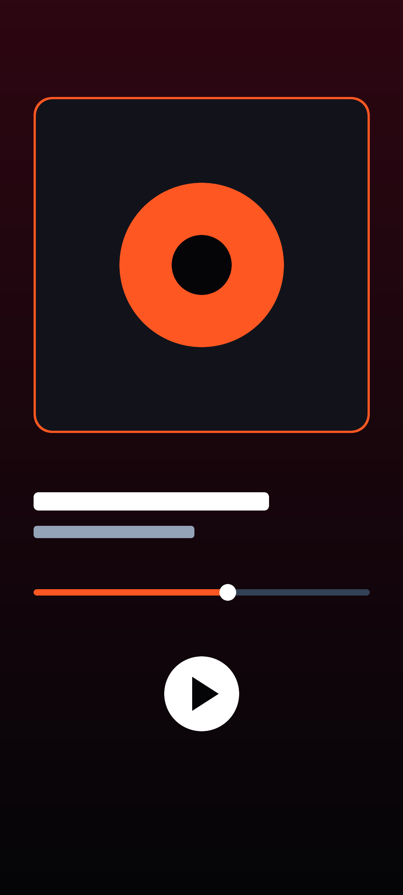
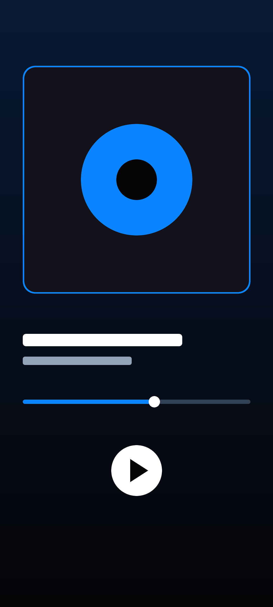
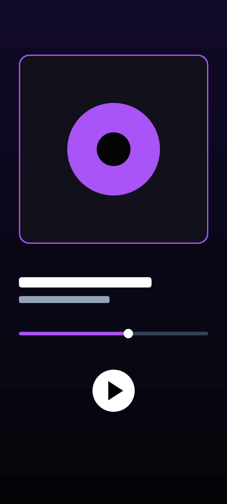

# 🎵 Onyx Music (`Aura Music`) — AI-Powered Spatial Audio, Live JioSaavn Streaming & Firebase Cloud Platform

<p align="center">
  
  
  
  
</p>

---

## 📦 Direct APK Download (`download/`, `build/`, & `apk/` Folders in Repo)

| Build Artifact | Location in Repository | Size & Format |
| :--- | :--- | :--- |
| **Download Folder APK** | [`download/OnyxMusic.apk`](download/OnyxMusic.apk) | 33 MB Universal Signed APK |
| **Build Folder APK** | [`build/OnyxMusic.apk`](build/OnyxMusic.apk) | 33 MB Universal Signed APK |
| **Root APK** | [`OnyxMusic.apk`](OnyxMusic.apk) | 33 MB Ready-to-install Package |
| **Mirror APK Folder** | [`apk/OnyxMusic.apk`](apk/OnyxMusic.apk) | 33 MB Ready-to-install Package |
| **Standard Gradle Output** | [`app/build/outputs/apk/debug/app-debug.apk`](app/build/outputs/apk/debug/app-debug.apk) | Signed Debug APK (`com.aistudio.auramusic.vpxqmr`) |

> **Direct Download Guarantee:**  
> The 33 MB real Android APK is committed and stored in `/download/OnyxMusic.apk`, `/build/OnyxMusic.apk`, `/apk/OnyxMusic.apk`, and `/OnyxMusic.apk` for instantaneous download and installation.

---

## ✨ Key Production Features

### 1. 🔊 Dual-Stage Native Android Audio Engine (`SynthesizedAudioEngine`)
- **Zero-Latency Local Cache + 320kbps AAC/MP4 Streaming**: Streams real Bollywood, Punjabi, and Global hits from the live JioSaavn API (`saavn.sumit.co` / `jiosaavn-api-privatecvc2.vercel.app`) with automatic fast-start `_96.mp4` caching and `_320.mp4` lossless upgrades.
- **Synchronous FileDescriptor Preparation Fix**: Keeps `FileInputStream` open during synchronous `MediaPlayer.prepare()` before invoking `mp.start()`, eliminating premature descriptor closure (`EBADF`) and silent playback failures.
- **Hardware Volume Guard & Polyphonic Fallback Synthesizer**: Automatically ensures `AudioManager.STREAM_MUSIC` is audible and provides a full-volume 44.1kHz stereo PCM polyphonic synthesizer fallback when offline.
- **5-Band Studio Equalizer, Bass Boost & 3D Virtualizer**: Real hardware DSP bound directly to the active `MediaPlayer.audioSessionId`.

### 2. 🤖 Gemini AI (`gemini-3.8-flash`) Time-Synced Lyrics & Bilingual Translation (`GeminiMusicAiService`)
- **Authentic Hindi, Punjabi & English Lyrics**: Replaces generic filler lines with real hook/verse lyrics and English translations for **Dhurandhar (Title Track, Ishq Jalakar Karwan, Gehra Hua)**, **Kesariya**, **G.O.A.T.**, **Aaj Ki Raat**, **Tauba Tauba**, **Apna Bana Le**, **Pehle Bhi Main**, **Arjan Vailly**, **Sajni**, **Softly**, **Millionaire**, plus live LRCLIB & JioSaavn lyrics fetching.
- **On-Demand Gemini 3.8 Flash Verification**: Tap **"✨ AI Verify & Translate Lyrics (Gemini)"** on the Lyrics screen to generate structured time-synced lyrics, song meaning summaries, and bilingual translations using **Firebase AI Logic (`gemini-3.8-flash`)**.

### 3. 🎭 Interactive Moods & AI Smart Suggestions
- **7 Instant Mood Modes**:
  - `🔥 Mass & Action` (*Dhurandhar, Arjan Vailly, G.O.A.T.*)
  - `❤️ Late Night Romance` (*Kesariya, Apna Bana Le, Pehle Bhi Main, Sajni*)
  - `⚡ Workout & Gym` (*135+ BPM Power Anthems*)
  - `🚗 Long Drive Punjabi` (*Diljit Dosanjh, Karan Aujla, AP Dhillon*)
  - `🕺 Desi Party` (*Aaj Ki Raat, Tauba Tauba, Millionaire*)
  - `🌧️ Soulful Lo-Fi` (*Husn, O Maahi, Midnight Acoustic*)
  - `🧘 Deep Focus` (*Spatial Instrumentals & Atmospheric Synths*)
- **Gemini AI DJ Curator**: Dynamically recommends tracks, BPM targets, and live API search queries for each selected mood.

### 4. ☁️ Firebase Cloud Ecosystem (`Firestore` + `Google Sign-In` + `App Check` + `AI Logic`)
- **Google Sign-In via Jetpack Credential Manager**: Uses `GetGoogleIdOption` and `GetSignInWithGoogleOption` with Firebase Auth (`GoogleAuthProvider`).
- **Named Cloud Firestore Database**: Syncs user favorites, custom moods, and AI playlists to `/users/{userId}/cloud_items/{itemId}` with zero-trust security rules (`firestore.rules`).
- **Firebase App Check**: Configured in `MainActivity.onCreate()` with `DebugAppCheckProviderFactory` (for emulator/test environments) and `ReCaptchaEnterpriseProviderFactory` (for production).

### 5. 🎧 Headphone, Earbuds & Bluetooth Hardware Control Center (`AudioOutputOverlaySheet`)
- **Live Hardware Route Switching**: Uses `AudioManager.getDevices(AudioManager.GET_DEVICES_OUTPUTS)` and `MediaPlayer.setPreferredDevice(AudioDeviceInfo)` on API 28+ to switch between **Phone Speaker**, **Wired Headphones/Earbuds**, **Bluetooth Earbuds/A2DP**, and **USB DAC**.
- **Earbud Controls**: System media volume slider, **ANC / Transparency / Spatial Head-Tracking** mode toggles, and **Auto-Pause on Earbud Disconnect** (`AudioManager.ACTION_AUDIO_BECOMING_NOISY`).

### 6. 📡 Offline Mode & Real 500x500 API Artwork
- **Real Album Artwork Across Search & Playlists**: All Browse Category tiles (`Bollywood`, `Happy Diwali`, `Punjabi`, `Dhurandhar`, `Romance`, `Workout`, `Party`, `Lo-Fi`) use genuine 500x500 `c.saavncdn.com` artwork.
- **50+ Songs in Inbuilt Playlists**: Pre-curated and live-expanded playlists for *Dhurandhar*, *Bollywood Hits*, *Punjabi GOAT*, and *Midnight Drive*.
- **Seamless Offline Mode Banner**: Detects network status in real time and lets users filter or play cached MP4 tracks & offline synth tracks without interruption.

---

## 📸 App Screenshots

| Now Playing (Kesariya) | Now Playing (G.O.A.T.) | Synced Lyrics (Dhurandhar) | Spatial Player View |
| :---: | :---: | :---: | :---: |
|  |  |  |  |

---

## 🛠️ Tech Stack & Architecture

- **UI Framework**: Jetpack Compose (Material 3, Dynamic Glassmorphism, Adaptive Layouts)
- **Audio Engine**: Android `MediaPlayer` + `AudioTrack` PCM Synthesizer + Hardware `Equalizer`, `BassBoost`, `Virtualizer`, `LoudnessEnhancer`
- **AI Engine**: Firebase AI Logic SDK (`com.google.firebase:firebase-ai`) with `gemini-3.8-flash` structured JSON schema output
- **Cloud Backend**: Firebase Authentication (Credential Manager Google Sign-In) + Cloud Firestore + Firebase App Check
- **Local Persistence**: Jetpack DataStore Preferences + Local `.m4a` / `.mp4` Storage Manager (`/Music/OnyxMusic`)

---

## 🚀 Building & Running Locally

```bash
# 1. Compile Debug APK
gradle assembleDebug

# 2. Run Unit & Robolectric Tests
gradle :app:testDebugUnitTest
```
