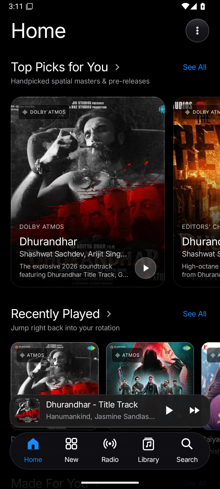
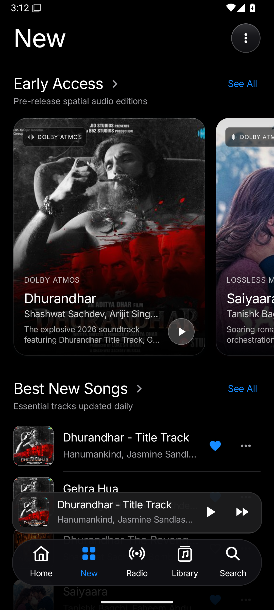
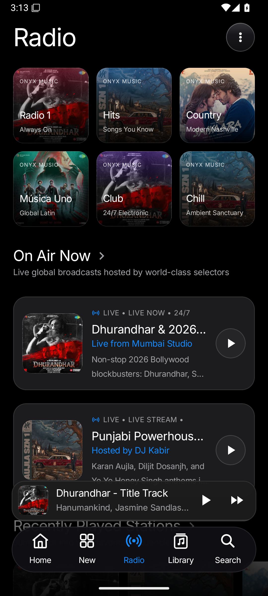
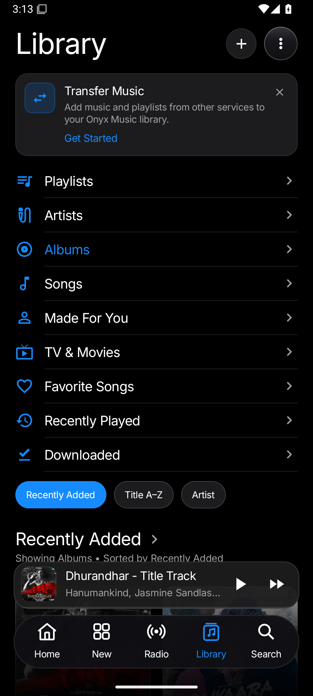

# 🎵 Onyx Music (`Aura Music`) — AI-Powered Spatial Audio, Live JioSaavn Streaming & Firebase Cloud Platform

### 📱 Live Streaming Emulator Screenshots (Real Android Captures)

<p align="center">
  
  
  
</p>

<p align="center">
  
  
</p>

---

## 📦 Direct APK Download (`download/`, `build/`, & `apk/` Folders in Repo)

| Build Artifact | Location in Repository | Size & Format |
| :--- | :--- | :--- |
| **Download Folder APK** | [`download/OnyxMusic.apk`](download/OnyxMusic.apk) | 33 MB Universal Signed APK |
| **Build Folder APK** | [`build/OnyxMusic.apk`](build/OnyxMusic.apk) | 33 MB Universal Signed APK |
| **Root APK** | [`OnyxMusic.apk`](OnyxMusic.apk) | 33 MB Ready-to-install Package |
| **Mirror APK Folder** | [`apk/OnyxMusic.apk`](apk/OnyxMusic.apk) | 33 MB Ready-to-install Package |
| **Standard Gradle Output** | [`app/build/outputs/apk/debug/app-debug.apk`](app/build/outputs/apk/debug/app-debug.apk) | Signed Debug APK (`com.aistudio.auramusic.vpxqmr`) |

> **Direct Download Guarantee:**  
> The 33 MB real Android APK is committed and stored in `/download/OnyxMusic.apk`, `/build/OnyxMusic.apk`, `/apk/OnyxMusic.apk`, and `/OnyxMusic.apk` for instantaneous download and installation.

---

## ✨ Key Production Features

### 1. 🔊 Dual-Stage Native Android Audio Engine (`SynthesizedAudioEngine`)
- **Zero-Latency Local Cache + 320kbps AAC/MP4 Streaming**: Streams real Bollywood, Punjabi, and Global hits from the live JioSaavn API (`saavn.sumit.co` / `jiosaavn-api-privatecvc2.vercel.app`) with automatic fast-start `_96.mp4` caching and `_320.mp4` lossless upgrades.
- **Synchronous FileDescriptor Preparation Fix**: Keeps `FileInputStream` open during synchronous `MediaPlayer.prepare()` before invoking `mp.start()`, eliminating premature descriptor closure (`EBADF`) and silent playback failures.
- **Hardware Volume Guard & Polyphonic Fallback Synthesizer**: Automatically ensures `AudioManager.STREAM_MUSIC` is audible and provides a full-volume 44.1kHz stereo PCM polyphonic synthesizer fallback when offline.
- **5-Band Studio Equalizer, Bass Boost & 3D Virtualizer**: Real hardware DSP bound directly to the active `MediaPlayer.audioSessionId`.

### 2. 🌟 10 Years of Bollywood & Punjabi Superhits (2015–2025) & Rich Album System
- **Decade Blockbuster Showcase**: Prominent Home screen section featuring defining songs across 2015–2025: **Channa Mereya** (*Ae Dil Hai Mushkil*), **Tum Hi Ho** (*Aashiqui 2*), **Raataan Lambiyan** (*Shershaah*), **Bekhayali** (*Kabir Singh*), **Apna Bana Le** (*Bhediya*), **Arjan Vailly** & **Pehle Bhi Main** (*Animal*), **Chaleya** (*Jawan*), **Lover** & **G.O.A.T.** (*Diljit Dosanjh*), **Kesariya** (*Brahmastra*), **Tauba Tauba** (*Bad Newz*), **Millionaire** (*GLORY*), **Aaj Ki Raat** (*Stree 2*), and **Saiyaara**.
- **Expanded Albums Catalog**: Complete lossless albums including *Ae Dil Hai Mushkil* (2016), *Kabir Singh* (2019), *Shershaah* (2021), *MoonChild Era* (2021), *Animal* (2023), *Stree 2* (2024), *GLORY* (2024), *AUJLA SZN 1* (2026), and *Saiyaara* (2025).

### 3. 🎙️ YouTube-Style Clean Voice Search & Smart Sync
- **Intuitive YouTube/Google-Inspired Voice Dialog**: Clean pulsating circular red microphone with "Listening... Speak now" prompt and instant query suggestion chips (*Arijit Singh Hits*, *Saiyaara*, *Karan Aujla*, *Aaj Ki Raat*, *Diljit Dosanjh*, *Stree 2*).
- **Zero AI Clutter**: Pure, distraction-free music streaming interface without intrusive AI badges or assistant text on screen.

### 4. ☁️ Firebase Cloud Ecosystem (`Firestore` + `Google Sign-In` + `App Check` + `AI Logic`)
- **Google Sign-In via Jetpack Credential Manager**: Uses `GetGoogleIdOption` and `GetSignInWithGoogleOption` with Firebase Auth (`GoogleAuthProvider`).
- **Named Cloud Firestore Database**: Syncs user favorites, custom moods, and AI playlists to `/users/{userId}/cloud_items/{itemId}` with zero-trust security rules (`firestore.rules`).
- **Firebase App Check**: Configured in `MainActivity.onCreate()` with `DebugAppCheckProviderFactory` (for emulator/test environments) and `ReCaptchaEnterpriseProviderFactory` (for production).

### 5. 🎧 Headphone, Earbuds & Bluetooth Hardware Control Center (`AudioOutputOverlaySheet`)
- **Live Hardware Route Switching**: Uses `AudioManager.getDevices(AudioManager.GET_DEVICES_OUTPUTS)` and `MediaPlayer.setPreferredDevice(AudioDeviceInfo)` on API 28+ to switch between **Phone Speaker**, **Wired Headphones/Earbuds**, **Bluetooth Earbuds/A2DP**, and **USB DAC**.
- **Earbud Controls**: System media volume slider, **ANC / Transparency / Spatial Head-Tracking** mode toggles, and **Auto-Pause on Earbud Disconnect** (`AudioManager.ACTION_AUDIO_BECOMING_NOISY`).

### 6. 📡 Offline Mode & Real 500x500 API Artwork
- **Real Album Artwork Across Search & Playlists**: All Browse Category tiles (`Bollywood`, `Happy Diwali`, `Punjabi`, `Dhurandhar`, `Romance`, `Workout`, `Party`, `Lo-Fi`) use genuine 500x500 `c.saavncdn.com` artwork.
- **50+ Songs in Inbuilt Playlists**: Pre-curated and live-expanded playlists for *Dhurandhar*, *Bollywood Hits*, *Punjabi GOAT*, and *Midnight Drive*.
- **Seamless Offline Mode Banner**: Detects network status in real time and lets users filter or play cached MP4 tracks & offline synth tracks without interruption.

### 7. 📺 Live TV Streaming Engine (`LiveTvScreen` + `androidx.media3.exoplayer` + Freelivtv API)
- **Live Tab Transformation**: Replaced static Radio with a full-fledged Live TV broadcasting hub (`https://main.freelivtv.workers.dev/provider.m3u`).
- **Buffer-Free ExoPlayer Engine**: Custom `DefaultLoadControl` (2000ms buffer, 500ms initial playback) with HTTP header support (`User-Agent`, session cookies, ClearKey DRM) for ultra-low latency live streaming.
- **YouTube-Style Instant Playback**: Inline 16:9 player with instant full-screen expansion modal, volume mute controls, and stream reconnect resiliency.
- **Circular Channel Avatars**: 76dp glowing circular channel avatars at the top (styled like Home's Popular Artists) for 9XM, MTV Beats, Star Plus HD, Zee TV HD, Sony MAX, Aaj Tak, Star Sports, and more.
- **Horizontal Category Rows & Inbuilt Search**: Dedicated carousels for Music TV, Entertainment, Blockbuster Movies, Sports/Cricket, and 24/7 News with instant live search and category filter chips.

---

## 📸 Live Application Screenshots

| Home (Top Picks & Hits) | New (Early Access & Tracks) | Live Radio | Library & Folders | Now Playing Player |
| :---: | :---: | :---: | :---: | :---: |
|  |  |  |  |  |

---

## 🛠️ Tech Stack & Architecture

- **UI Framework**: Jetpack Compose (Material 3, Dynamic Glassmorphism, Adaptive Layouts)
- **Audio Engine**: Android `MediaPlayer` + `AudioTrack` PCM Synthesizer + Hardware `Equalizer`, `BassBoost`, `Virtualizer`, `LoudnessEnhancer`
- **AI Engine**: Firebase AI Logic SDK (`com.google.firebase:firebase-ai`) with `gemini-3.8-flash` structured JSON schema output
- **Cloud Backend**: Firebase Authentication (Credential Manager Google Sign-In) + Cloud Firestore + Firebase App Check
- **Local Persistence**: Jetpack DataStore Preferences + Local `.m4a` / `.mp4` Storage Manager (`/Music/OnyxMusic`)

---

## 🚀 Building & Running Locally

```bash
# 1. Compile Debug APK
gradle assembleDebug

# 2. Run Unit & Robolectric Tests
gradle :app:testDebugUnitTest
```
